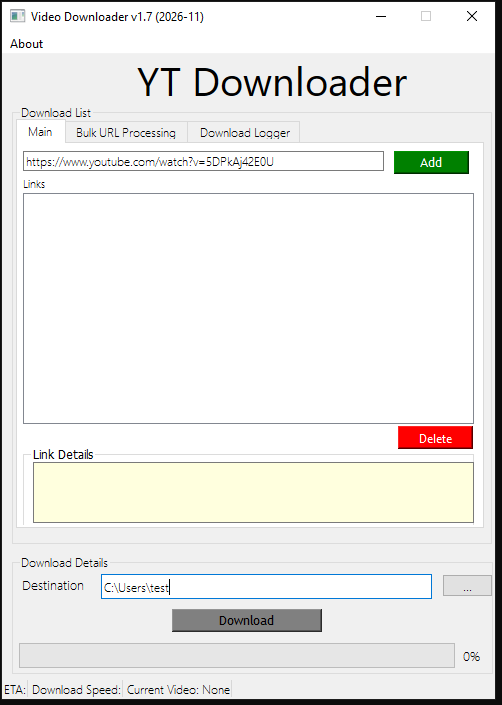
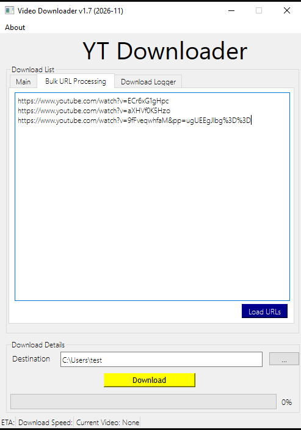
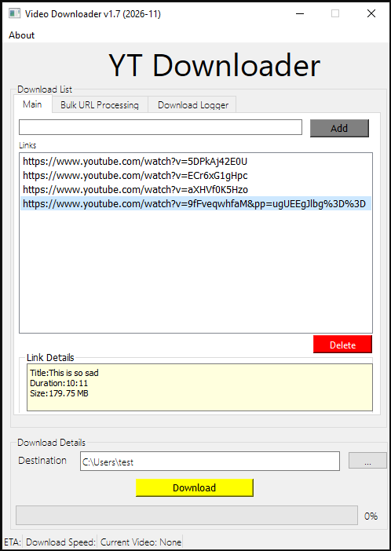
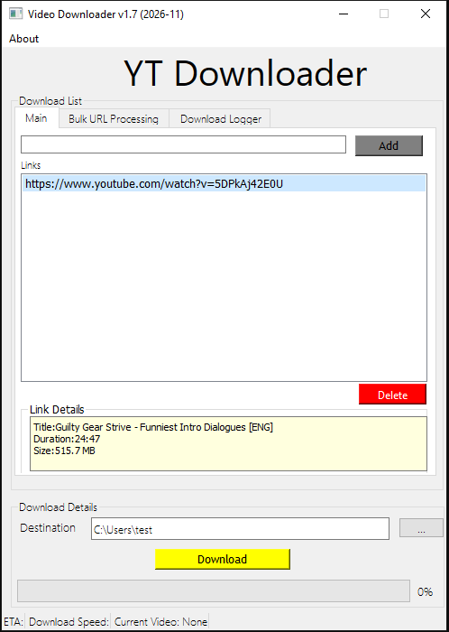
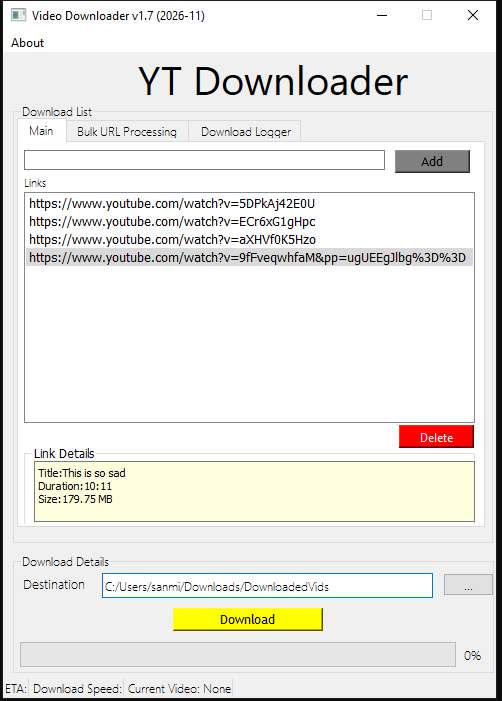
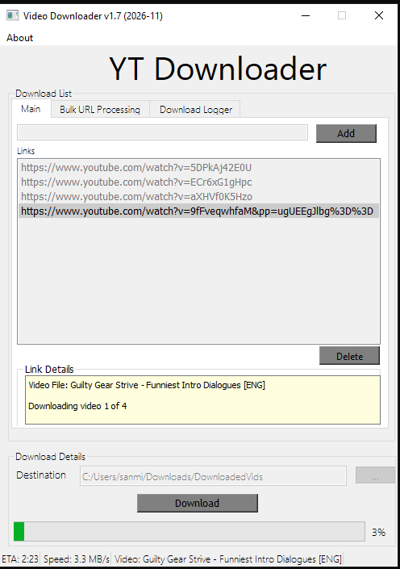
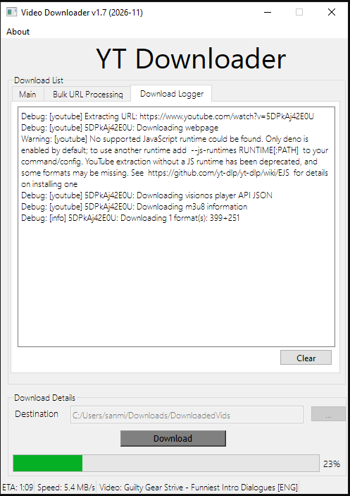
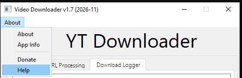

# VideoDownloader

Timi's Educational video ~Downloader that allows you download a variety of videos from Youtube and more

## **[Download your copy of the software here](https://1drv.ms/u/c/a3b5ee900d5de3c0/IQDWSsPABuCgT5qIIKkBuaTtAbhvaHgnHUO2usFndiUOL_k)**

# How to use
Just paste the link, add it to the list, press download and you'll be able to store it offline.

Paste your link into the link box and press "Add" to put it in the list:

Alternatively, you can copy and paste a bunch of line seperated links and paste them here

Then press "Load URLs" to add them all

Click on the links in the list to see their metadata

Set the path to download the videos to

Click the download button to start the download

While it is running, you have a download logger that gives info on the download and extra details on the status bar

If you need help there is click About > Help, which will open a PDF file using your default PDF viewer

